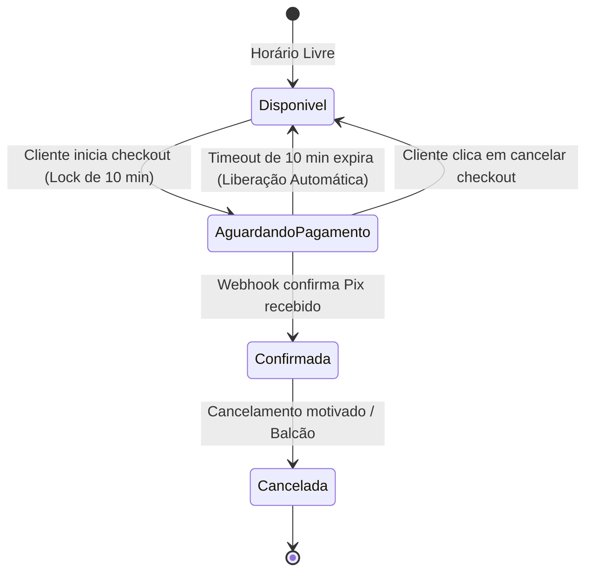

# Especificação Técnica: Motor de Pagamento Pix Real e Lock Transacional de Concorrência (Fase 2)

**Data:** 16/10/2026  
**Status:** Aprovado para Implementação  
**Escopo:** Implementação do sistema de lock temporário anti double-booking e motor de gateway Pix real com webhook transacional e liberação automática de slots expirados.

---

## 1. Contexto e Problema de Negócio

No modelo acadêmico inicial do Reservei, a simulação de Pix aprovava pagamentos no clique de um botão no frontend. Em um produto Micro-SaaS real:
1. **Risco de Double-Booking em Tempo Real:** Se dois clientes abrirem a grade para a Quadra 1 às 19:00 e ambos gerarem Pix simultaneamente, ambos pagariam pelo mesmo horário.
2. **Conferência Manual de Comprovantes:** Donos de arenas gastam horas conferindo comprovantes de Pix falsificados ou com agendamentos futuros no WhatsApp.
3. **Slots "Presos" por Desistência:** Se um cliente inicia o checkout e abandona o celular, aquele horário não pode ficar eternamente indisponível para outros interessados.

---

## 2. Arquitetura da Solução

### 2.1. Máquina de Estados e Lock de Concorrência (Anti Double-Booking)



1. **Geração do Lock:** No momento em que o cliente clica em "Ir para Pagamento", o sistema define:
   * `status = 'em_processamento'`
   * `expira_em = NOW() + INTERVAL '10 minutes'`
   * `pix_txid = [ID único gerado pelo Gateway]`
2. **Proteção de Leitura:** A função de horários ocupados (`getHorariosOcupados`) considera ocupado qualquer slot com status `confirmada` OU (`em_processamento` com `expira_em > NOW()`).
3. **Expiração Automática:** Qualquer consulta ou rotina de varredura que encontre reservas com status `em_processamento` e `expira_em <= NOW()` transiciona o status automaticamente para `cancelada` com motivo `"tempo_esgotado"`, liberando o slot imediatamente para outros clientes.

---

## 3. Modelo de Dados (PostgreSQL / Supabase)

Colunas adicionadas à tabela `public.reservas`:
* `pix_txid` (`TEXT`): Identificador transacional único fornecido pelo banco central / gateway.
* `pix_copia_cola` (`TEXT`): Código textual Pix ("EMV Payload") para cópia no aplicativo bancário.
* `pix_qr_code_url` (`TEXT`): URL pública ou imagem Base64 do QR Code para escaneamento.
* `expira_em` (`TIMESTAMPTZ`): Data e hora exata de expiração do lock temporário.
* `pago_em` (`TIMESTAMPTZ`): Data e hora exata da liquidação confirmada pelo webhook.
* `gateway_provedor` (`TEXT`): Provedor utilizado (`'asaas' | 'mercadopago' | 'efi' | 'mock'`).
* `gateway_transacao_id` (`TEXT`): ID interno da cobrança no gateway.

---

## 4. Camada de Gateways e Webhooks (Clean Architecture)

```text
src/lib/pagamento/
├── types.ts                      # Interfaces: PixCobranca, GatewayProvider, WebhookEvent
├── lockService.ts                # Regras de lock temporal, validação de concorrência e expiração
├── paymentGateway.ts             # Interface desacoplada e Fábrica de Provedores
├── gateways/
│   ├── mockGateway.ts            # Provedor de testes e desenvolvimento offline
│   └── asaasGateway.ts           # Provedor oficial Asaas com suporte a Pix instantâneo
└── pagamentoService.ts           # Casos de uso: gerarPixReserva, processarWebhookPagamento
```

### 4.1. Endpoint do Webhook
* **Rota:** `/api/webhooks/pagamentos` (Next.js Route Handler).
* **Método:** `POST`.
* **Segurança:** Validação do cabeçalho de autenticação do webhook (`asaas-access-token` ou HMAC signature).
* **Ação:** Atualiza status para `confirmada`, preenche `pago_em`, emite recibo e notifica o cliente.
